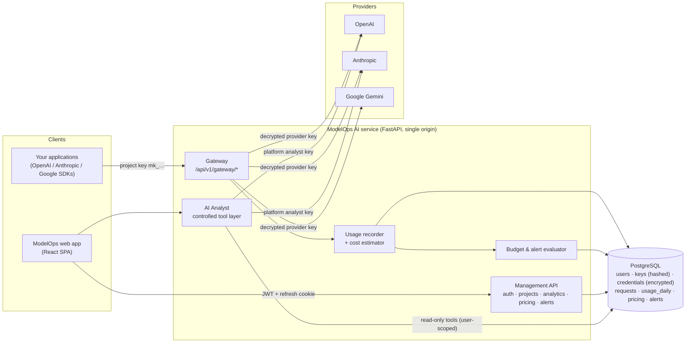

<div align="center">

# ModelOps AI

**Monitoring, observability and cost intelligence for AI APIs — OpenAI, Anthropic Claude and Google Gemini in one dashboard.**

[](https://github.com/OlehDatsyk/modelops-ai/actions/workflows/ci.yml)


</div>

ModelOps AI is a multi-user SaaS platform that sits between your applications and AI providers. Your apps send
requests to a **ModelOps gateway** instead of calling providers directly; the gateway forwards them with your stored
(encrypted) provider key, returns the provider's response unchanged, and records **safe metadata only** — tokens,
latency, status, errors and an estimated cost. On top of that data you get dashboards, request logs, cost breakdowns,
budgets, alerts and an **AI Analyst** that answers questions about your usage from your real numbers.

> **Live:** <https://modelops-ai.onrender.com> · API docs: <https://modelops-ai.onrender.com/api/docs> ·
> health: <https://modelops-ai.onrender.com/api/v1/health> (Render free tier: the first request after idle can take ~50 s).

> **Project status:** v1.0.0 — feature-complete for the scope in [PROJECT_REVIEW.md](PROJECT_REVIEW.md), with automated
> tests and CI. Costs are **estimates** derived from a configurable pricing table, not provider invoices.

---

## Contents

- [Features](#features)
- [Screenshots](#screenshots)
- [Architecture](#architecture)
- [Technology stack](#technology-stack)
- [Quick start](#quick-start)
- [Configuration](#configuration)
- [Using the gateway](#using-the-gateway)
- [Testing](#testing)
- [Deployment (Render)](#deployment-render)
- [Security](#security)
- [Project structure](#project-structure)
- [Roadmap](#roadmap)
- [Documentation](#documentation)
- [Author & license](#author--license)

## Features

| Area | What you get |
| --- | --- |
| **API gateway** | OpenAI-, Anthropic- and Gemini-compatible endpoints (`/chat/completions`, `/messages`, `generateContent`) with **streaming**, request IDs, timeouts, provider-error passthrough and per-key rate limiting. Works with the official SDKs by changing the base URL. |
| **Provider integrations** | Separate adapters per provider: auth headers, request formats, token-usage extraction (incl. streaming SSE), error classification and **key validation** via the provider's free model-list endpoint, which also discovers available models. |
| **Analytics dashboard** | Requests, input/output tokens, estimated spend, average latency, successes/failures, error rate; spend, volume, token and error-rate charts; provider and model distribution; comparison with the previous period. Ranges: 24h, 7d, 30d, 90d or custom. Filter by project and provider. |
| **Cost intelligence** | Pricing table separate from request records (reference catalogue + per-account overrides), **pricing snapshot stored with every request**, unknown prices shown as *unknown* (never $0), spend by provider/model/project, daily and monthly summaries, cost calculator. |
| **Projects** | Multiple projects per account, allowed providers per project, hashed project API keys (create/revoke, shown once), per-project usage and spend. |
| **Request logs** | Search, filter (provider, status, model, project, date), sort, paginate and inspect any request including error details and the cost calculation. |
| **Budgets & alerts** | Daily/monthly budgets with warning thresholds and optional **enforcement** (gateway returns HTTP 402), alert rules on error rate, request volume, token usage or spend, de-duplicated in-app notifications with history. |
| **AI Analyst** | Ask “Why did my costs increase this week?” — an OpenAI or Anthropic model answers by calling a **fixed set of read-only analytics tools** scoped to your account (no SQL generation), and shows the supporting data. |
| **Accounts & security** | Argon2id passwords, short-lived JWT access tokens + rotating httpOnly refresh cookies with reuse detection, sessions list, sign-out everywhere, password change, account deletion, lockout after failed logins. |

## Screenshots

> **Placeholders** — screenshots will be added here once the hosted demo has real traffic.
> To capture your own: run the app, send some gateway requests, and save images to `docs/screenshots/`.

| Screen | Image |
| --- | --- |
| Dashboard | *placeholder — `docs/screenshots/dashboard.png`* |
| Request logs with detail drawer | *placeholder — `docs/screenshots/requests.png`* |
| Costs & pricing | *placeholder — `docs/screenshots/costs.png`* |
| AI Analyst | *placeholder — `docs/screenshots/analyst.png`* |

## Architecture



**Request flow:** project key → hashed lookup → provider allowed? → credential decrypted in memory → enforced budget
check → upstream call (buffered or streamed) → usage extracted → pricing resolved and snapshotted → request row +
daily roll-up written in one transaction → budgets/alert rules evaluated in the background → provider response
returned with an `x-modelops-request-id` header.

In production the React app is built into the same Docker image and served by FastAPI, so the UI and API share one
origin (no CORS, strict `SameSite` cookies). For development, Vite proxies `/api` to the backend.

## Technology stack

| Layer | Technologies |
| --- | --- |
| Backend | Python 3.12, FastAPI, Pydantic v2, SQLAlchemy 2, Alembic, psycopg 3, httpx, PyJWT, argon2-cffi, cryptography (Fernet + HKDF) |
| Database | PostgreSQL 16 |
| Frontend | React 18, TypeScript, Vite 6, Tailwind CSS 4, TanStack Query, React Router, Recharts, Lucide icons |
| Testing | pytest + respx (mocked provider HTTP), Vitest + Testing Library |
| Infrastructure | Docker (multi-stage), Docker Compose, Render Blueprint, GitHub Actions |

No Redis or paid external service is required to start the app or run the test suite.

## Quick start

**Prerequisites:** Python 3.12+, Node.js 20+, and PostgreSQL 16 (Docker Desktop is the easiest way to get it).

### One-click launchers

- **Windows:** double-click `Start App.bat`
- **macOS / Linux:** double-click `Start App (Mac).command` (or run `./"Start App (Mac).command"`)

They check Python/Node, create `.env` with generated secrets **only if it does not exist**, create the virtual
environment, install dependencies, start PostgreSQL with Docker Compose if the database is unreachable, run migrations,
and start the backend (`:8000`) and frontend (`:5173`).

### Manual setup

```bash
cp .env.example .env                      # then set JWT_SECRET_KEY and MASTER_ENCRYPTION_KEY
docker compose up -d db                   # PostgreSQL on 127.0.0.1:5434

cd backend
python -m venv .venv && source .venv/bin/activate      # Windows: .venv\Scripts\activate
pip install -r requirements-dev.txt
python -m app.cli generate-secrets        # prints values for the two secrets above
alembic upgrade head
python -m app.cli seed-pricing
uvicorn app.main:app --reload --port 8000

cd ../frontend
npm install
npm run dev                               # http://localhost:5173
```

### Full stack in Docker

```bash
docker compose up --build                 # http://localhost:8000 (API + UI on one origin)
```

## Configuration

All settings are environment variables (see [.env.example](.env.example) for the full list).

| Variable | Required | Description |
| --- | --- | --- |
| `DATABASE_URL` | yes | PostgreSQL URL (`postgres://`, `postgresql://` and `postgresql+psycopg://` are accepted) |
| `JWT_SECRET_KEY` | yes | ≥ 32 random characters, signs access tokens |
| `MASTER_ENCRYPTION_KEY` | yes | ≥ 32 random characters, encrypts provider keys. Comma-separate keys to rotate |
| `ENVIRONMENT` | no | `development` (default), `production` or `test` |
| `CORS_ORIGINS` | no | Extra browser origins (not needed when the UI is served by the backend) |
| `AI_ANALYST_PROVIDER` / `AI_ANALYST_MODEL` / `AI_ANALYST_API_KEY` | no | Enables the AI Analyst (`openai` or `anthropic`) |
| `RATE_LIMIT_*_PER_MINUTE` | no | Auth, API and gateway rate limits |
| `MAX_REQUEST_BYTES` | no | Request body limit (default 2 MB) |

Provider API keys for OpenAI, Anthropic and Gemini are **not** environment variables — each user adds their own in
the **Providers** page, where they are encrypted at rest.

## Using the gateway

1. Add a provider key in **Providers**. 2. Create a project and an API key in **Projects**. 3. Change your SDK's base URL.

```bash
curl https://YOUR-HOST/api/v1/gateway/openai/chat/completions \
  -H "Authorization: Bearer mk_YOUR_PROJECT_KEY" \
  -H "Content-Type: application/json" \
  -d '{"model": "gpt-4o-mini", "messages": [{"role": "user", "content": "Hello"}]}'
```

```python
from openai import OpenAI
client = OpenAI(api_key="mk_YOUR_PROJECT_KEY", base_url="https://YOUR-HOST/api/v1/gateway/openai")

import anthropic
claude = anthropic.Anthropic(api_key="mk_YOUR_PROJECT_KEY", base_url="https://YOUR-HOST/api/v1/gateway/anthropic")
```

```bash
curl https://YOUR-HOST/api/v1/gateway/gemini/generate \
  -H "Authorization: Bearer mk_YOUR_PROJECT_KEY" -H "Content-Type: application/json" \
  -d '{"model": "gemini-2.5-flash", "contents": [{"parts": [{"text": "Hello"}]}]}'
```

Full reference: [API_DOCUMENTATION.md](API_DOCUMENTATION.md) and the interactive docs at `/api/docs`.

## Testing

```bash
docker compose up -d db                  # creates the modelops_test database on first start
cd backend && pytest                     # 87 tests: auth, gateway (mocked providers), pricing, analytics,
                                         # isolation, alerts, analyst, middleware, migrations
ruff check . && ruff format --check .

cd ../frontend
npm run lint && npm run typecheck && npm test && npm run build
```

Provider calls are mocked with `respx`; the suite never calls a paid API. Tests run against real PostgreSQL and build
the schema with the Alembic migrations (upgrade and downgrade are both exercised).

## Deployment (Render)

The repository includes a [Render Blueprint](render.yaml): one Docker **web service** (API + UI) and one **PostgreSQL**
database. In the Render dashboard choose **New → Blueprint**, select this repository and apply. Render generates
`JWT_SECRET_KEY` and `MASTER_ENCRYPTION_KEY`, wires `DATABASE_URL`, runs migrations on start and health-checks
`/api/v1/health`. Optionally set the three `AI_ANALYST_*` variables in the dashboard. If your workspace's single free
database is already taken, use `render.shared-db.yaml` to run ModelOps in its own database on that server. Details:
[INSTRUCTION.md → Deploying to Render](INSTRUCTION.md#deploying-to-render).

## Security

- Passwords: Argon2id. Access tokens: 15-minute JWTs kept in memory. Refresh tokens: random, hashed at rest, rotated on
  every use, `httpOnly` + `Secure` + `SameSite=Strict` cookie, reuse triggers revocation of all sessions.
- Provider keys: Fernet (AES-128-CBC + HMAC-SHA256) with an HKDF-derived key from `MASTER_ENCRYPTION_KEY`; only a
  masked hint is ever returned. Project keys: 256-bit random, stored as SHA-256 hashes.
- Every query is scoped to the authenticated user; cross-user access returns 404 (covered by tests).
- Rate limits, body-size limits, strict CORS, security headers (CSP, HSTS, X-Frame-Options…), sanitised errors with
  request IDs, and a redacting log filter. Prompts and completions are **never stored or logged**.

See [SECURITY.md](SECURITY.md) for the full policy and how to report a vulnerability.

## Project structure

```
modelops-ai/
├── backend/
│   ├── app/
│   │   ├── api/routes/        # auth, providers, projects, gateway, analytics, requests, pricing, alerts, analyst, health
│   │   ├── core/              # config, security, crypto, logging, middleware, rate limiting, errors
│   │   ├── db/                # engine/session, declarative base
│   │   ├── models/            # SQLAlchemy models
│   │   ├── providers/         # OpenAI, Anthropic and Gemini adapters
│   │   ├── schemas/           # Pydantic request/response models
│   │   ├── services/          # gateway, usage recording, pricing, analytics, alerts, analyst
│   │   ├── cli.py             # seed-pricing, rotate-keys, check, generate-secrets
│   │   └── main.py
│   ├── alembic/               # migrations
│   └── tests/                 # pytest suite
├── frontend/
│   └── src/                   # pages, components, lib (API client, auth, formatting), tests
├── docker/                    # entrypoint, Postgres init script
├── .github/workflows/ci.yml
├── Dockerfile · docker-compose.yml · render.yaml
├── Start App.bat · Start App (Mac).command
└── *.md                       # documentation
```

## Roadmap

- Email / Slack / webhook delivery for alerts (currently in-app only)
- Organisations and team members with roles
- Cached-input and batch pricing tiers; automatic price catalogue updates
- Additional endpoints (OpenAI Responses API, embeddings) and providers
- Shared rate-limit store (Redis) for multi-instance deployments
- Data retention policies and CSV export

## Documentation

| Document | Contents |
| --- | --- |
| [INSTRUCTION.md](INSTRUCTION.md) | Installing, configuring, running, using, deploying and maintaining the app |
| [API_DOCUMENTATION.md](API_DOCUMENTATION.md) | Every endpoint with authentication, request and response examples |
| [SECURITY.md](SECURITY.md) | Security model, logging and privacy policy, reporting |
| [PROJECT_REVIEW.md](PROJECT_REVIEW.md) | Completed features, architecture, test results, limitations |
| [CHANGELOG.md](CHANGELOG.md) | Release history |

## Author & license

Created by **[OlehDatsyk](https://github.com/OlehDatsyk)**. Released under the [MIT License](LICENSE).
